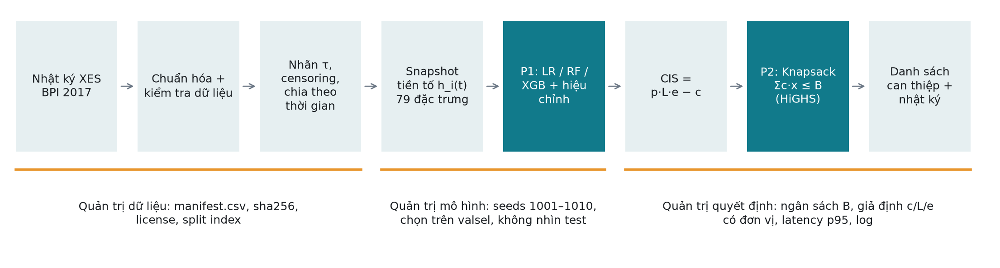
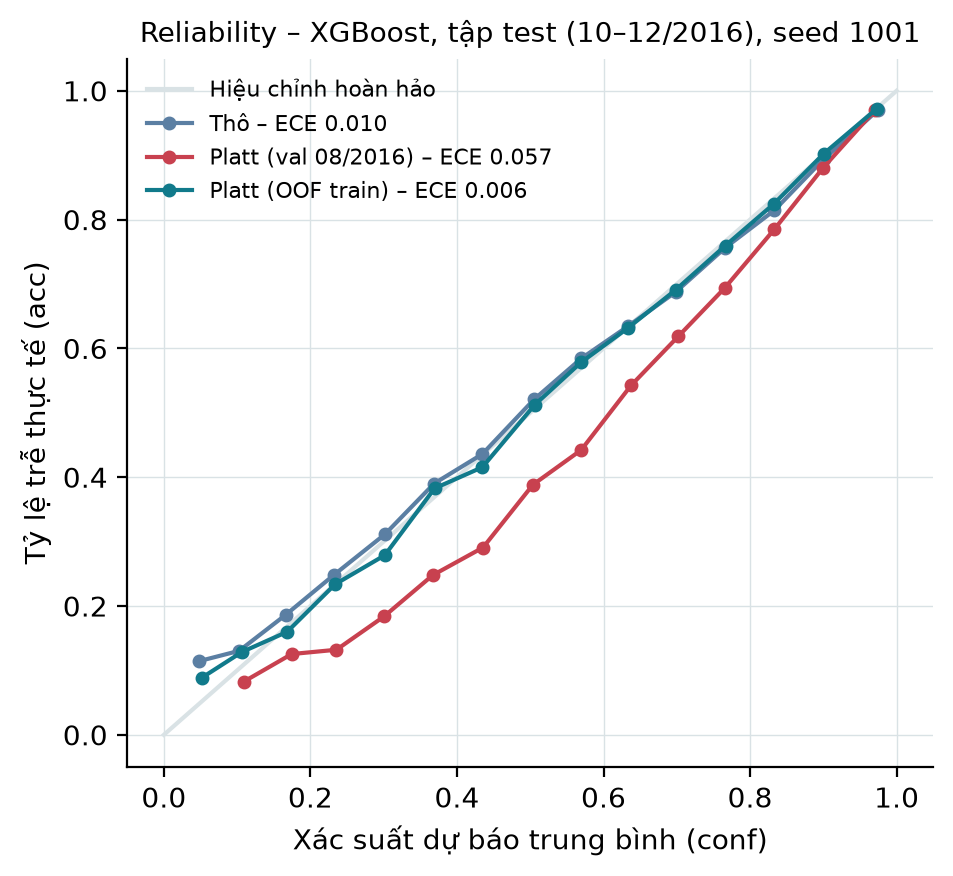
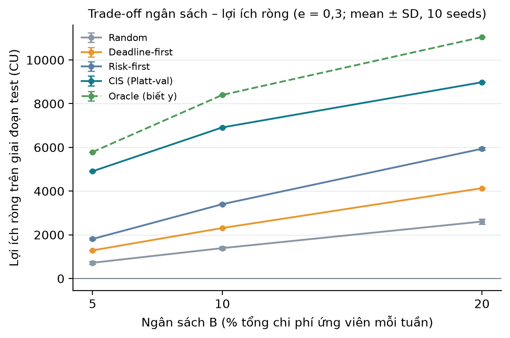
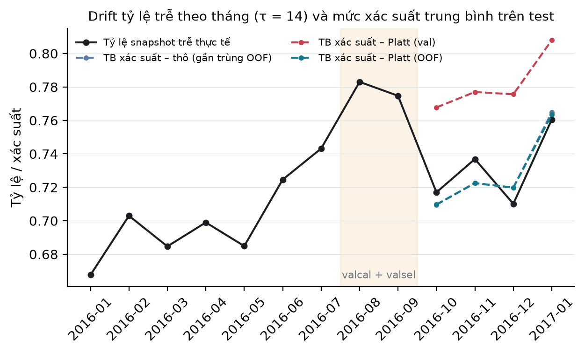

# Tóm tắt

Đề tài xét bài toán: tại mỗi thời điểm quyết định, chọn tối đa một ngân sách B hồ sơ đang chạy để can thiệp nhằm giảm thiệt hại do trễ hạn. Chúng tôi xây dựng quy trình hai giai đoạn trên nhật ký BPI Challenge 2017 (1.202.267 sự kiện, 31.509 hồ sơ vay): (P1) dự báo xác suất hồ sơ vượt ngưỡng τ = 14 ngày (kịch bản nghiên cứu, không phải SLA thật) từ tiền tố vết, có hiệu chỉnh xác suất; (P2) chọn hồ sơ bằng bài toán knapsack 0/1 trên điểm *Calibrated Intervention Score* CIS = p·L·e − c. Ba baseline dự báo (LR, RF, XGBoost) được tái lập với chia dữ liệu theo thời gian và 10 seeds; năm chính sách được so sánh dưới cùng ngân sách.

Kết quả chính (tập test 10–12/2016, B = 10%, e = 0,3, 10 seeds): XGBoost đạt AUC-ROC 0,765 và ECE 0,010 khi chưa hiệu chỉnh. Chính sách CIS-knapsack đạt lợi ích ròng mô phỏng 6.914 ± 9 CU so với 3.402 ± 31 CU của Risk-first (chênh +3.513 CU, 95% CI [+3.495; +3.529]) và đạt 82% mức Oracle. Ưu thế biến mất hoàn toàn khi chi phí và thiệt hại đồng nhất — lợi ích đến từ việc xét chi phí–thiệt hại, không phải từ bản thân bước hiệu chỉnh. Hiệu chỉnh Platt trên tháng 08/2016 làm ECE trên test xấu đi (0,010 → 0,057) và giảm lợi ích ròng 120 CU [111; 129] do tỷ lệ trễ của giai đoạn validation (78%) cao hơn giai đoạn test (72%); hiệu chỉnh out-of-fold trên train không gặp vấn đề này. Gán nhãn "không trễ" cho hồ sơ bị censored làm ECE tăng từ 0,015 lên 0,111. Mọi lợi ích can thiệp là **tối ưu trong mô phỏng** với c, L, e giả định; dữ liệu quan sát không cho phép kết luận nhân quả.

# 1. Giới thiệu

## 1.1. Bối cảnh và nhu cầu

Tổ chức vận hành quy trình nghiệp vụ (xét duyệt hồ sơ vay, xử lý yêu cầu, mua sắm) đã lưu nhật ký sự kiện trong ERP/BPM nhưng thường không biết hồ sơ đang chạy nào sắp trễ hạn và nên can thiệp vào đâu trước. Nguồn lực can thiệp (chuyên viên xử lý gấp, gọi khách hàng, chuyển cấp duyệt) có hạn. Giám sát quy trình dự báo (predictive process monitoring – PPM) cung cấp xác suất rủi ro cho từng hồ sơ, nhưng một mô hình có AUC cao chỉ bảo đảm *thứ tự* rủi ro, không bảo đảm *độ lớn* xác suất đáng tin — trong khi quyết định phân bổ ngân sách cần nhân xác suất với thiệt hại và so với chi phí.

## 1.2. Câu hỏi nghiên cứu

- **RQ1.** Hiệu chỉnh xác suất có giảm sai số đánh giá rủi ro và giúp ưu tiên can thiệp tốt hơn so với chỉ dựa vào AUC không?
- **RQ2.** Khi ngân sách cố định, kết hợp rủi ro–chi phí–thời hạn có tăng mức thiệt hại kỳ vọng tránh được trong mô phỏng không?
- **RQ3.** Kết quả thay đổi thế nào khi xử lý đúng hồ sơ censored, khi mất sự kiện và khi quy trình bị drift?

## 1.3. Đóng góp (ở mức bài tập lớn)

1. Một quy trình tái lập được, từ XES đến quyết định can thiệp, với chia theo thời gian, xử lý right-censoring và kiểm thử chống rò rỉ (31 unit test).
2. Phát biểu CIS-knapsack và bộ thí nghiệm *paired-budget* đánh giá **quyết định** chứ không chỉ năng lực phân lớp, kèm mệnh đề về trường hợp CIS trùng Risk-first và xác nhận thực nghiệm.
3. Bằng chứng thực nghiệm rằng hiệu chỉnh trên giai đoạn validation bị dịch chuyển tỷ lệ nền có thể làm xấu cả độ hiệu chỉnh lẫn quyết định, và rằng gán nhãn sai cho hồ sơ censored làm lệch xác suất nghiêm trọng.

Tính mới chỉ là đề xuất có điều kiện: khảo sát hiện mới kiểm tra 13 công trình gần (mục 3), chưa đủ 20–30 công trình như yêu cầu của luận văn.

# 2. Phát biểu bài toán

## 2.1. Định nghĩa

**Sự kiện và nhật ký.** Sự kiện e = (c, a, t, r, x) gồm mã hồ sơ, hoạt động, thời điểm, tài nguyên và thuộc tính. Nhật ký L là tập hữu hạn sự kiện. **Vết** σ_c là dãy sự kiện của hồ sơ c theo thời gian (phá hòa bằng thứ tự trong file). **Tiền tố** h_c(t) = ⟨e ∈ σ_c : #time(e) ≤ t⟩ là thông tin duy nhất mô hình được dùng.

**Cycle time.** T_c = thời điểm sự kiện kết quả đầu tiên (A_Pending, A_Denied hoặc A_Cancelled) − thời điểm A_Create Application, tính bằng ngày. Các bước W_ phát sinh sau khi có kết quả không tính vào thời hạn.

**Nhãn trễ và right-censoring.** Với ngưỡng τ: y_c = 1[T_c > τ] nếu hồ sơ đã có kết quả trước thời điểm trích xuất t_ext. Nếu chưa có kết quả, ta chỉ biết T_c > U_c = t_ext − start_c: khi U_c > τ thì đã chắc y_c = 1; khi U_c ≤ τ thì y_c **chưa biết** và không được gán 0.

**Hiệu chỉnh.** Mô hình hiệu chỉnh hoàn hảo nếu P(y = 1 | p̂ = p) = p. Đo bằng Brier score và ECE (15 bin đều):

$$
\text{Brier} = \frac{1}{N}\sum_{i=1}^{N}(p_i - y_i)^2, \qquad \text{ECE} = \sum_{k=1}^{K}\frac{|B_k|}{N}\,\big|\text{acc}(B_k) - \text{conf}(B_k)\big|
$$

**Chi phí, thiệt hại, hiệu quả.** c_i > 0 là chi phí can thiệp, L_i ≥ 0 là thiệt hại nếu trễ, e_i ∈ [0, 1] là tỷ lệ rủi ro bị loại bỏ nếu can thiệp. Cả ba là **giả định thí nghiệm** có đơn vị chi phí quy ước (CU).

## 2.2. Bài toán hình thức

**Đầu vào:** nhật ký L đã chia theo thời gian; τ; tại mỗi epoch t, tập hồ sơ đang mở và chưa quá hạn O(t) = {1, …, N} với tiền tố h_i(t); c_i, L_i, e_i; ngân sách B = β · Σ_i c_i.

**Giai đoạn P1 (dự báo có hiệu chỉnh):** học f trên train, học hàm hiệu chỉnh g trên một tập tách biệt, đặt p_i = g(f(h_i(t))).

**Giai đoạn P2 (chọn can thiệp):**

$$
\max_{x \in \{0,1\}^N} \sum_{i=1}^{N} \big(p_i L_i e_i - c_i\big)\, x_i \quad \text{v.đ.k.} \quad \sum_{i=1}^{N} c_i x_i \le B
$$

**Đầu ra:** vectơ quyết định x*, xác suất p_i, điểm CIS_i = p_i L_i e_i − c_i, và các chỉ số đánh giá.

**Giả định.** (A1) τ = 14 ngày là kịch bản; (A2) c, L, e giả lập ⇒ kết quả P2 chỉ là tối ưu trong mô phỏng; (A3) can thiệp vào i chỉ ảnh hưởng i; (A4) can thiệp không làm thay đổi tiền tố quan sát được của các epoch sau.

**Ràng buộc.** (C1) không dùng sự kiện tương lai; (C2) mỗi hồ sơ thuộc đúng một tập, test không dùng để chọn tham số; (C3) hồ sơ chưa biết nhãn không gán y = 0; (C4) Σ c_i x_i ≤ B; (C5) seeds 1001–1010, manifest và log.

## 2.3. Ví dụ tự kiểm

Ba hồ sơ A (p = 0,80; L = 10; c = 2; còn 2 ngày), B (0,55; 8; 1; 5 ngày), C (0,40; 15; 3; 1 ngày), e = 1. CIS: A = 6,0; B = 3,4; C = 3,0. Với ngân sách 1 ca, chọn A. Với B = 3 CU, các tập khả thi {A}, {B}, {C}, {A, B} cho 6; 3,4; 3; 9,4 ⇒ chọn {A, B}. Deadline-first chọn C (3,0). Phản ví dụ cho Risk-first: thêm D (p = 0,9; L = 2; c = 1; CIS = 0,8); với ngân sách 1 CU, Risk-first chọn D, CIS chọn B (3,4). Phản ví dụ cho greedy theo tỷ số: X (CIS 3,5; c = 1), Y (6; c = 3), B = 3 ⇒ greedy được 3,5, tối ưu {Y} = 6. Các ví dụ này được tái hiện trong `tests/test_core.py`.

## 2.4. Mệnh đề

**Mệnh đề 1 (tính đúng của P2).** Với mọi p, L, e, c và B, nghiệm của MILP ở mục 2.2 tối đa hóa tổng CIS kỳ vọng trong các tập thỏa ngân sách. *Chứng minh:* MILP là phát biểu chính xác của knapsack 0/1; HiGHS trả về nghiệm tối ưu khi trạng thái là Optimal. Chúng tôi kiểm chứng thêm bằng quy hoạch động O(N·B) trên 20 bài toán ngẫu nhiên (test `test_milp_matches_dp`).

**Mệnh đề 2 (khi nào CIS trùng Risk-first).** Nếu c_i ≡ c, L_i ≡ L, e_i ≡ e và mọi p_i L e − c > 0, thì CIS-knapsack chọn đúng ⌊B/c⌋ hồ sơ có p_i lớn nhất, tức trùng Risk-first. *Chứng minh:* khi chi phí bằng nhau, ràng buộc trở thành giới hạn số lượng k = ⌊B/c⌋; giá trị p_i L e − c đơn điệu tăng theo p_i nên tập tối ưu là k hồ sơ có p lớn nhất. Nếu có hồ sơ với CIS ≤ 0, CIS bỏ qua chúng còn Risk-first vẫn chọn — khi đó CIS không kém hơn. ∎ Hệ quả: mọi ưu thế của CIS so với Risk-first phải đến từ sự khác biệt về chi phí/thiệt hại giữa các hồ sơ hoặc từ việc từ chối can thiệp có giá trị âm. Kịch bản "homog" ở mục 6.2 xác nhận điều này.

**Độ phức tạp.** Dựng đặc trưng: O(M log M) với M sự kiện (sắp xếp + merge_asof). Knapsack 0/1 là NP-khó nhưng có thuật toán giả đa thức O(N·B) khi c nguyên; với N ≈ 950 ứng viên/epoch, HiGHS giải trong 93 ms (trung vị) và 234 ms (p95). Greedy theo tỷ số chạy O(N log N).

# 3. Công trình liên quan

Bảng 1 tóm tắt các công trình đã đối chiếu (DOI được kiểm chứng qua Crossref, xem `results/references_verified.json`). Nhận xét dựa trên phạm vi bài báo công bố; "chưa kiểm tra" nghĩa là *không thuộc thiết lập được trình bày* theo hiểu biết của chúng tôi, không phải khẳng định chưa ai nghiên cứu.

| Công trình | Bài toán | Phương pháp | Dữ liệu | Đã làm – chưa xét so với đề tài |
|---|---|---|---|---|
| [1] Tax và cs. (2017) | Dự báo hoạt động kế tiếp, thời điểm, phần còn lại của vết, remaining time | LSTM trên tiền tố | Log công khai (Helpdesk, BPI 2012) | Đã làm: LSTM đa nhiệm, mã công khai. Chưa xét: xác suất trễ có hiệu chỉnh, phân bổ ngân sách can thiệp |
| [2] Teinemaa và cs. (2019) | Dự báo kết cục (outcome) theo tiền tố – review và benchmark | Nhiều cách bucketing/encoding + bộ phân lớp (RF, XGBoost, LR, SVM) | Nhiều log thật, gồm BPI 2017 | Đã làm: benchmark lớn, mã hóa tổng hợp + cây thường mạnh. Chưa xét: độ hiệu chỉnh, quyết định can thiệp |
| [3] Verenich và cs. (2019) | Dự báo thời gian còn lại – survey và cross-benchmark | So sánh nhiều phương pháp hồi quy/học sâu | Nhiều log thật | Đã làm: so sánh thống nhất. Chưa xét: chuyển dự báo thành quyết định dưới ngân sách |
| [4] Teinemaa và cs. (2018) | Prescriptive: phát cảnh báo để giảm kết cục xấu | Ngưỡng cảnh báo trên xác suất, mô hình chi phí (can thiệp, hiệu quả giảm thiểu, kết cục xấu) | Log thật | Đã làm: khung chi phí cho cảnh báo. Chưa xét: ngân sách chung cho nhiều hồ sơ cạnh tranh, censoring |
| [5] Fahrenkrog-Petersen và cs. (2022) | Mở rộng hệ cảnh báo: cảnh báo ngay hay chờ | Khung alarm-based có xét thời điểm | Nhiều log thật | Đã làm: quyết định thời điểm cảnh báo. Chưa xét: knapsack theo ngân sách mỗi epoch |
| [6] Shoush & Dumas (2022) | Prescriptive dưới ràng buộc nguồn lực | Suy luận nhân quả ước lượng hiệu ứng can thiệp để ưu tiên hồ sơ | Log thật | Đã làm: ưu tiên theo hiệu ứng khi nguồn lực có hạn. Chưa xét (theo hiểu biết): chi phí–thiệt hại không đồng nhất, hiệu chỉnh dưới drift |
| [7] Metzger và cs. (2019) | Thích nghi quy trình chủ động | Ensemble học sâu cho ước lượng độ tin cậy của dự báo | Dữ liệu thật | Đã làm: dùng độ tin cậy để quyết định thích nghi. Chưa xét: phân bổ ngân sách giữa nhiều hồ sơ |
| [8] Metzger và cs. (2020) | Khi nào kích hoạt thích nghi | Học tăng cường trực tuyến trên dự báo + độ tin cậy | Dữ liệu thật | Đã làm: học chính sách kích hoạt. Chưa xét: tối ưu chính xác dưới ngân sách cố định |
| [9] Bozorgi và cs. (2023) | Học khi nào can thiệp | Suy luận nhân quả + học tăng cường | Log thật | Đã làm: kết hợp hiệu ứng nhân quả và thời điểm. Chưa xét: đánh giá tác động của hiệu chỉnh xác suất lên quyết định |
| [10] Kubrak và cs. (2022) | Tổng quan prescriptive process monitoring | Rà soát tài liệu có hệ thống | — | Đã làm: phân loại mục tiêu, loại can thiệp, nguồn dữ liệu. Chưa xét: thực nghiệm |
| [17] Maisenbacher & Weidlich (2017) | Concept drift trong PPM | Học tăng dần | Log mô phỏng/thật | Đã làm: cập nhật mô hình khi drift. Chưa xét: drift làm hỏng bộ hiệu chỉnh và quyết định ngân sách |
| [13] Niculescu-Mizil & Caruana (2005) | Chất lượng xác suất của bộ học có giám sát | Platt scaling, isotonic regression | Bộ dữ liệu chuẩn (không phải quy trình) | Đã làm: so sánh hiệu chỉnh. Chưa xét: dữ liệu theo thời gian, dịch chuyển phân phối |
| [15] Guo và cs. (2017) | Hiệu chỉnh mạng nơ-ron hiện đại | ECE, temperature scaling | Ảnh/văn bản | Đã làm: chuẩn hóa ECE. Chưa xét: validation và test khác phân phối |

*Bảng 1. So sánh công trình liên quan.*

**Khoảng trống (có điều kiện).** Các công trình PPM [1–3] tối ưu chất lượng dự báo, không giải bài phân bổ ngân sách. Các công trình prescriptive [4–9] xét can thiệp theo ngưỡng cảnh báo, theo học tăng cường hoặc theo hiệu ứng nhân quả, nhưng trong các bài đã đối chiếu chúng tôi chưa thấy thiết lập đồng thời: (i) knapsack theo chi phí–thiệt hại không đồng nhất ở mỗi epoch với ngân sách cố định, (ii) đánh giá tác động của việc chọn giai đoạn hiệu chỉnh dưới dịch chuyển tỷ lệ nền lên *quyết định*, và (iii) xử lý right-censoring khi gán nhãn trễ. Khoảng trống này cần được kiểm tra lại với 20–30 công trình gần nhất trước khi tuyên bố tính mới trong luận văn.

# 4. Phương pháp

## 4.1. Quy trình kỹ thuật

Hình 1 mô tả luồng xử lý và ba điểm quản trị (dữ liệu, mô hình, quyết định).

{width=100%}

1. **Đọc và chuẩn hóa.** Đọc XES bằng PM4Py, đổi tên cột về case_id, activity, timestamp, resource; sắp xếp ổn định theo (case, timestamp, thứ tự trong file); kiểm tra trùng lặp (0 sự kiện trùng).
2. **Nhãn.** Tính T_c, U_c, y_c theo mục 2.1 với t_ext = 01/02/2017 (sự kiện cuối cùng trong log).
3. **Chia theo thời gian bắt đầu hồ sơ.** Train: 01–07/2016; valcal: 08/2016 (fit bộ hiệu chỉnh); valsel: 09/2016 (chọn mô hình, bộ hiệu chỉnh, ngưỡng F1); test: 10–12/2016.
4. **Snapshot tiền tố.** Mỗi ngày lúc 00:00 UTC, mọi hồ sơ đang mở và chưa quá hạn tạo một mẫu (h_i(t), y_i). 79 đặc trưng: thời gian đã trôi, thời gian từ sự kiện cuối, số sự kiện, số tài nguyên khác nhau, số lần xuất hiện của 26 hoạt động và 7 trạng thái lifecycle, hoạt động cuối (one-hot), số tiền vay (log), loại hồ sơ, mục tiêu vay (14 giá trị), ngày trong tuần lúc bắt đầu. Danh mục hoạt động/mục tiêu vay chỉ lấy từ train. Ghép trạng thái bằng `merge_asof(direction="backward")` và kiểm tra bằng assertion rằng mọi sự kiện dùng có timestamp ≤ t.
5. **Mô hình.** Logistic regression (chuẩn hóa), Random Forest (300 cây), XGBoost (400 cây, độ sâu 6). Siêu tham số cố định trước, không tune trên test.
6. **Hiệu chỉnh.** Bốn biến thể: thô; Platt và Isotonic fit trên valcal; Platt fit trên dự báo out-of-fold (GroupKFold 5 phần theo case) của train ("Platt-OOF").
7. **Chính sách.** Mỗi thứ Hai 00:00 UTC (15 epoch, trung bình 945 ứng viên/epoch). So sánh Random, Deadline-first, Risk-first, CIS-greedy, CIS-knapsack (MILP, HiGHS) với các nguồn xác suất khác nhau, và Oracle (dùng y thật; cận trên theo từng epoch). Hồ sơ đã được can thiệp không xét lại ở epoch sau.

## 4.2. Mã giả

```
Input: log L, cấu hình Θ (τ, β, e, c(·), L(·)), seeds S = {1001..1010}
1  E ← chuẩn hóa(L); kiểm tra schema, trùng lặp, thứ tự thời gian
2  C ← build_cases(E, τ, t_ext)        # T_c, U_c, y_c ∈ {0,1,NaN}
3  split ← theo start_c: train | valcal | valsel | test; lưu index + sha256
4  FS ← fit danh mục đặc trưng trên train
5  X ← snapshot_features(E, C, FS)     # merge_asof, assert ev_time ≤ t
6  for s in S:
7      f_s ← fit(model, X_train, seed=s)
8      g_s ← fit_calibrator(f_s(X_valcal))  (hoặc OOF trên train)
9      chọn (model, calibrator, ngưỡng) trên valsel theo Brier; KHÔNG nhìn test
10     for mỗi epoch t (thứ Hai) trên test:
11         O ← hồ sơ test đang mở, chưa quá hạn, chưa can thiệp
12         p ← g_s(f_s(h_i(t))); c, L ← giả định; B ← β·Σc
13         x ← argmax Σ(p·L·e − c)x  s.t. Σc·x ≤ B      # MILP
14         ghi nhận lợi ích thực hiện Σ x(y·L·e − c) theo nhãn thật
15 Output: metrics.csv, policy.csv, cấu hình, log, hình
```

## 4.3. Giả định chi phí – thiệt hại

c_i = 1 + min(2, số offer đã tạo) CU (hồ sơ nhiều offer tốn công can thiệp hơn); L_i = 5 + 0,0005 × RequestedAmount CU (giá trị hồ sơ bị đe dọa); e ∈ {0,1; 0,3; 0,5}; β ∈ {5, 10, 20}%. Kịch bản "decay": e_i = e · min(1, Δ_i / (τ/2)) — can thiệp sát hạn kém tác dụng. Kịch bản "homog": c ≡ 1, L ≡ 10 để kiểm tra Mệnh đề 2. Tất cả là giả định thí nghiệm, không có nguồn từ ngân hàng.

# 5. Thiết kế thực nghiệm

## 5.1. Dữ liệu

BPI Challenge 2017 [11]: nhật ký quy trình xin vay của một tổ chức tài chính Hà Lan, giấy phép 4TU General Terms of Use, tải ngày 14/11/2026, MD5 khớp giá trị công bố. Log không được phân phối lại; repo chỉ chứa lệnh tải. Hồ sơ dữ liệu: 1.202.267 sự kiện, 31.509 hồ sơ, 26 hoạt động, 149 tài nguyên, 01/01/2016 – 01/02/2017; 31.411 hồ sơ có kết quả (17.228 A_Pending, 10.431 A_Cancelled, 3.752 A_Denied); 98 hồ sơ chưa có kết quả, tất cả đã quan sát hơn 31 ngày nên được gán chắc chắn là trễ với τ = 14. Cycle time trung vị 19,1 ngày; tỷ lệ trễ 64,0% (τ = 14), 80,5% (τ = 10), 46,1% (τ = 21).

| Tập | Hồ sơ | Tỷ lệ trễ (hồ sơ) | Snapshot | Tỷ lệ trễ (snapshot) | Censored đã chắc trễ |
|---|---|---|---|---|---|
| Train (01–07/2016) | 17.345 | 62.4% | 213.363 | 71.0% | 0 |
| Valcal (08/2016) | 3.085 | 71.0% | 39.343 | 78.0% | 0 |
| Valsel (09/2016) | 3.042 | 70.6% | 39.176 | 76.7% | 0 |
| Test (10–12/2016) | 8.037 | 62.8% | 98.380 | 71.9% | 98 |

*Bảng 2. Thông tin dữ liệu với τ = 14 ngày (giả định). Nhãn: thật (quan sát), trừ 98 hồ sơ chưa kết thúc được gán trễ vì đã quan sát > τ. Giấy phép: 4TU General Terms of Use. 79 đặc trưng/snapshot.*

## 5.2. Bảng câu hỏi – dữ liệu – baseline – chỉ số – phân tích

| RQ | Dữ liệu | Baseline | Chỉ số | Phân tích | Không kết luận được nếu thiếu |
|---|---|---|---|---|---|
| RQ1 | BPI 2017, τ = 14, test 10–12/2016 | 3 mô hình × 4 cách hiệu chỉnh | AUC-ROC, AUC-PR, F1, Brier, ECE; lợi ích ròng của CIS theo nguồn p | So sánh cặp theo seed, bootstrap CI | Bộ hiệu chỉnh fit trên tập khác test và cùng split |
| RQ2 | Như trên + kịch bản c, L, e | Random, Deadline-first, Risk-first, Oracle | Lợi ích ròng, thiệt hại tránh được, chi phí, tỷ lệ trúng ca trễ, latency | 3 β × 3 e × 2 kịch bản × 10 seeds; kịch bản homog | Cùng ngân sách, cùng tập ứng viên, cùng xác suất |
| RQ3 | Cắt dữ liệu train tại 01/08/2016; mất 0/10/30% sự kiện; τ ∈ {10, 14, 21}; theo tháng | Cách gán nhãn censored; log sạch | ECE, AUC, Brier, lợi ích ròng | Ablation từng yếu tố | Nhãn thật của test không đổi giữa các biến thể |

## 5.3. Giao thức

Seeds 1001–1010 cho mô hình ngẫu nhiên, chính sách Random và bootstrap. Báo cáo mean ± SD qua 10 seeds; khoảng tin cậy 95% bằng bootstrap trên chênh lệch cặp theo seed (5.000 lần lấy mẫu). Lưu ý: SD qua seed chỉ phản ánh biến thiên do huấn luyện, không phản ánh biến thiên do mẫu dữ liệu; vì test là một giai đoạn duy nhất, CI không bao gồm bất định về giai đoạn. Phần cứng: CPU Intel 12 luồng, 16 GB RAM, Windows 11; Python 3.11.9, scikit-learn 1.9.0, XGBoost 3.2.0, SciPy 1.17.1 (HiGHS), PM4Py 2.7.23. Toàn bộ huấn luyện chính mất 20,6 phút.

# 6. Kết quả

## 6.1. Dự báo và hiệu chỉnh (RQ1)

| Mô hình | Hiệu chỉnh | AUC-ROC | AUC-PR | F1 | Brier | ECE | ECE (valsel) | Huấn luyện (s) |
|---|---|---|---|---|---|---|---|---|
| LR | Thô | 0.743 ± 0.000 | 0.880 ± 0.000 | 0.846 ± 0.000 | 0.1718 ± 0.0000 | 0.0288 ± 0.0000 | 0.0603 | 3.2 |
| LR | Platt (val 08/2016) | 0.743 ± 0.000 | 0.880 ± 0.000 | 0.847 ± 0.000 | 0.1769 ± 0.0000 | 0.0713 ± 0.0000 | 0.0259 | 3.2 |
| LR | Isotonic (val 08/2016) | 0.743 ± 0.000 | 0.876 ± 0.000 | 0.846 ± 0.000 | 0.1769 ± 0.0000 | 0.0732 ± 0.0000 | 0.0322 | 3.2 |
| LR | Platt (OOF train) | 0.743 ± 0.000 | 0.880 ± 0.000 | 0.847 ± 0.000 | 0.1717 ± 0.0000 | 0.0274 ± 0.0000 | 0.0609 | 3.2 |
| RF | Thô | 0.762 ± 0.000 | 0.891 ± 0.000 | 0.849 ± 0.000 | 0.1665 ± 0.0001 | 0.0212 ± 0.0010 | 0.0702 | 12.5 |
| RF | Platt (val 08/2016) | 0.762 ± 0.000 | 0.891 ± 0.000 | 0.849 ± 0.000 | 0.1721 ± 0.0001 | 0.0646 ± 0.0007 | 0.0321 | 12.5 |
| RF | Isotonic (val 08/2016) | 0.762 ± 0.000 | 0.885 ± 0.001 | 0.849 ± 0.000 | 0.1722 ± 0.0001 | 0.0616 ± 0.0006 | 0.0351 | 12.5 |
| RF | Platt (OOF train) | 0.762 ± 0.000 | 0.891 ± 0.000 | 0.849 ± 0.000 | 0.1658 ± 0.0001 | 0.0089 ± 0.0009 | 0.0617 | 12.5 |
| XGB | Thô | 0.765 ± 0.001 | 0.895 ± 0.000 | 0.848 ± 0.000 | 0.1652 ± 0.0001 | 0.0099 ± 0.0007 | 0.0523 | 4.3 |
| XGB | Platt (val 08/2016) | 0.765 ± 0.001 | 0.895 ± 0.000 | 0.848 ± 0.000 | 0.1699 ± 0.0001 | 0.0573 ± 0.0005 | 0.031 | 4.3 |
| XGB | Isotonic (val 08/2016) | 0.765 ± 0.000 | 0.890 ± 0.001 | 0.848 ± 0.000 | 0.1701 ± 0.0001 | 0.0574 ± 0.0005 | 0.034 | 4.3 |
| XGB | Platt (OOF train) | 0.765 ± 0.001 | 0.895 ± 0.000 | 0.848 ± 0.000 | 0.1651 ± 0.0001 | 0.0051 ± 0.0007 | 0.054 | 4.3 |

*Bảng 3. Hiệu quả dự báo trên test (mean ± SD qua 10 seeds; LR tất định nên SD = 0). F1 tại ngưỡng chọn trên valsel. Thời gian huấn luyện cho một seed trên toàn bộ train (213.363 snapshot).*

XGBoost tốt nhất về AUC-ROC (0,765) và Brier (0,165), LR kém nhất (0,743). Mọi bộ hiệu chỉnh đơn điệu giữ nguyên AUC. Trên valsel, Platt-val cải thiện ECE của XGBoost từ 0,052 xuống 0,031, nên quy trình chọn trên validation chọn **XGBoost + Platt-val** cho mô phỏng chính sách. Trên test, cùng bộ hiệu chỉnh này làm ECE xấu đi từ 0,010 lên 0,057 và Brier từ 0,1652 lên 0,1699. Hình 4 cho thấy nguyên nhân: tỷ lệ snapshot trễ là 71,0% ở train, 78,0% ở valcal, 76,7% ở valsel nhưng chỉ 71,9% ở test; bộ hiệu chỉnh học "dịch lên" để khớp tháng 8–9 và mang độ lệch đó sang test. Platt-OOF (fit trong phân phối train) giảm ECE xuống 0,005, tức bản thân việc hiệu chỉnh có ích; vấn đề nằm ở việc chọn giai đoạn hiệu chỉnh.

{width=62%}

Ảnh hưởng lên quyết định: với cùng mô hình, CIS dùng p thô đạt 7.034 ± 15 CU, CIS dùng Platt-val đạt 6.914 ± 9 CU; chênh +120 CU, 95% CI [+111; +129], dương ở cả 10 seed và ở cả 9 tổ hợp β × e. CIS dùng Platt-OOF (7.033) ngang p thô và gần trần chẩn đoán "hiệu chỉnh trên chính test" (7.040). Risk-first không bị ảnh hưởng vì hiệu chỉnh đơn điệu không đổi thứ tự.

**Trả lời RQ1.** AUC không phân biệt được các nguồn xác suất này (cùng 0,765) nhưng quyết định CIS thì có: sai lệch xác suất khoảng 5 điểm phần trăm làm mất 1,7% lợi ích ròng. Hiệu chỉnh trong phân phối train cải thiện ECE mà không làm hại quyết định; hiệu chỉnh trên giai đoạn bị dịch chuyển tỷ lệ nền làm hại cả hai. Ở dữ liệu này XGBoost thô đã gần hiệu chỉnh, nên biên cải thiện quyết định từ hiệu chỉnh là nhỏ; kết luận không nên khái quát cho mô hình kém hiệu chỉnh hơn (ví dụ mạng nơ-ron sâu) khi chưa thử.

## 6.2. Chính sách can thiệp (RQ2)

| Chính sách | Lợi ích ròng (CU) | Thiệt hại tránh được (CU) | Chi phí đã dùng (CU) | Số ca can thiệp | Tỷ lệ trúng ca trễ | Chênh lệch so với Risk-first [95% CI] |
|---|---|---|---|---|---|---|
| Random | 1390 ± 78 | 4118 ± 76 | 2727 ± 4 | 1349 | 0.710 ± 0.011 | -2011 [-2067; -1959] |
| Deadline-first | 2311 ± 0 | 5178 ± 0 | 2867 ± 0 | 1308 | 0.928 ± 0.000 | -1091 [-1109; -1073] |
| Risk-first | 3402 ± 31 | 6243 ± 32 | 2842 ± 1 | 1396 | 0.972 ± 0.002 | — |
| CIS-greedy | 6909 ± 12 | 9490 ± 12 | 2580 ± 1 | 1733 | 0.796 ± 0.001 | +3508 [+3489; +3525] |
| CIS (p thô) | 7034 ± 15 | 9633 ± 16 | 2599 ± 2 | 1712 | 0.817 ± 0.002 | +3632 [+3617; +3649] |
| CIS (Platt-val) | 6914 ± 9 | 9496 ± 10 | 2581 ± 2 | 1731 | 0.796 ± 0.001 | +3513 [+3495; +3529] |
| CIS (Platt-OOF) | 7033 ± 18 | 9631 ± 18 | 2598 ± 1 | 1713 | 0.816 ± 0.002 | +3631 [+3616; +3647] |
| CIS (hiệu chỉnh trên test – chẩn đoán) | 7040 ± 8 | 9640 ± 9 | 2600 ± 2 | 1712 | 0.818 ± 0.001 | +3638 [+3622; +3655] |
| Oracle (biết y) | 8401 ± 0 | 10929 ± 0 | 2528 ± 0 | 1705 | 1.000 ± 0.000 | +4999 [+4980; +5016] |

*Bảng 3b. Mô phỏng chính sách trên test, B = 10% tổng chi phí ứng viên mỗi tuần, e = 0,3, 15 epoch, 10 seeds (mean ± SD). Mô hình: XGBoost; nguồn xác suất mặc định Platt-val (được chọn trên valsel). CI 95%: bootstrap trên chênh lệch cặp theo seed. Biến thể "hiệu chỉnh trên test" là trần chẩn đoán, không hợp lệ để kết luận.*

CIS-knapsack đạt lợi ích ròng gấp hơn 2 lần Risk-first và 3 lần Deadline-first, trong khi dùng ít ngân sách hơn (2.581 so với 2.842 CU). Phân tích một epoch điển hình (epoch thứ 7, seed 1001): Risk-first chọn 117 hồ sơ có p trung bình 0,99, phần lớn chi phí 2–3 CU và thiệt hại trung bình 15,5 CU; CIS chọn 159 hồ sơ có p trung bình 0,88 nhưng 80 hồ sơ chi phí 1 CU và thiệt hại trung bình 26,5 CU. Tỷ lệ trúng ca trễ của CIS thấp hơn (0,80 so với 0,97) nhưng giá trị mỗi lần trúng cao hơn. Deadline-first ưu tiên hồ sơ sát hạn — có tỷ lệ trễ cao nhưng không xét giá trị.

{width=75%}

| Kịch bản | B | e | Random | Deadline-first | Risk-first | CIS (Platt-val) | CIS (p thô) | Oracle |
|---|---|---|---|---|---|---|---|---|
| const | 5% | 0.1 | -691 | -524 | -346 | 737 | 759 | 1040 |
| const | 5% | 0.3 | 719 | 1287 | 1808 | 4907 | 4988 | 5789 |
| const | 5% | 0.5 | 2129 | 3098 | 3962 | 9078 | 9217 | 10538 |
| const | 10% | 0.1 | -1355 | -1141 | -760 | 711 | 745 | 1142 |
| const | 10% | 0.3 | 1390 | 2311 | 3402 | 6914 | 7034 | 8401 |
| const | 10% | 0.5 | 4135 | 5763 | 7564 | 13244 | 13456 | 15684 |
| const | 20% | 0.1 | -2586 | -2438 | -1752 | 710 | 743 | 1146 |
| const | 20% | 0.3 | 2606 | 4133 | 5938 | 8981 | 9122 | 11048 |
| const | 20% | 0.5 | 7799 | 10703 | 13628 | 18147 | 18411 | 21471 |
| decay | 5% | 0.1 | -880 | -1340 | -1200 | 677 | 674 | 1025 |
| decay | 5% | 0.3 | 152 | -1161 | -754 | 4623 | 4629 | 5693 |
| decay | 5% | 0.5 | 1183 | -982 | -308 | 8595 | 8604 | 10373 |
| decay | 10% | 0.1 | -1713 | -2646 | -2259 | 694 | 689 | 1139 |
| decay | 10% | 0.3 | 315 | -2204 | -1095 | 6518 | 6548 | 8263 |
| decay | 10% | 0.5 | 2344 | -1761 | 70 | 12548 | 12600 | 15446 |
| decay | 20% | 0.1 | -3230 | -5010 | -4124 | 694 | 688 | 1146 |
| decay | 20% | 0.3 | 675 | -3585 | -1176 | 8243 | 8255 | 10905 |
| decay | 20% | 0.5 | 4580 | -2159 | 1772 | 16780 | 16807 | 21180 |
| homog | 10% | 0.3 | 1539 | 2495 | 2693 | 2693 | 2693 | 2682 |

*Bảng 4. Lợi ích ròng mô phỏng (CU, trung bình 10 seeds) theo ngân sách, hiệu quả can thiệp và kịch bản (const: e hằng; decay: e giảm khi sát hạn; homog: c ≡ 1, L ≡ 10).*

Các kiểm tra bổ sung:

- **Kịch bản homog** (c ≡ 1, L ≡ 10): CIS và Risk-first cho cùng 2.693 CU, đúng như Mệnh đề 2. Ưu thế của CIS ở kịch bản chính hoàn toàn đến từ tính không đồng nhất của chi phí–thiệt hại.
- **e = 0,1:** mọi baseline cho lợi ích ròng âm (từ −346 đến −2.586 CU) vì chi tiêu vào hồ sơ có giá trị kỳ vọng âm; CIS giữ dương (710–737 CU) nhờ từ chối can thiệp khi CIS ≤ 0.
- **Kịch bản decay:** Deadline-first âm ở mọi mức ngân sách; CIS vẫn dương và giảm 2–8% so với kịch bản hằng.
- **MILP so với greedy:** chênh +5 CU [+1; +9] — với ~950 ứng viên và chi phí ∈ {1, 2, 3}, greedy theo tỷ số gần tối ưu; lời giải chính xác chủ yếu có giá trị bảo đảm.
- **Oracle:** CIS đạt 61–86% mức Oracle; Oracle tối ưu từng epoch riêng rẽ nên không phải cận trên toàn cục (ở kịch bản homog Oracle thấp hơn CIS 11 CU).
- **Latency:** quyết định CIS-knapsack mỗi epoch 93 ms trung vị, 234 ms p95, tối đa 387 ms (450 lần).

**Trả lời RQ2.** Trong mô phỏng với giả định c, L, e đã nêu, kết hợp rủi ro–chi phí–thiệt hại tăng lợi ích ròng ở cả 18 tổ hợp có chi phí không đồng nhất. Kết luận phụ thuộc trực tiếp vào giả định chi phí–thiệt hại; nếu chúng đồng nhất thì không có ưu thế.

## 6.3. Độ bền (RQ3)

**Censoring.** Mô phỏng tình huống trích xuất dữ liệu huấn luyện sớm vào 01/08/2016: trong 17.345 hồ sơ train. 15.196 đã có kết quả. 971 chưa kết thúc nhưng đã chắc trễ. 1.178 chưa biết nhãn. Mô hình XGBoost (xác suất thô) được huấn luyện theo ba cách gán nhãn và đánh giá trên cùng tập test với nhãn thật (10 seeds).

| Cách xử lý | Mẫu train | Tỷ lệ trễ train | TB xác suất (test) | AUC | Brier | ECE | Lợi ích CIS | Lợi ích Risk-first |
|---|---|---|---|---|---|---|---|---|
| Gán 0 cho mọi hồ sơ chưa kết thúc (sai) | 205.207 | 0.609 | 0.608 | 0.745 | 0.1829 | 0.111 | 7010 | 2470 |
| Loại mọi hồ sơ chưa kết thúc | 184.105 | 0.679 | 0.691 | 0.764 | 0.1668 | 0.028 | 7085 | 3324 |
| Đúng: giữ hồ sơ chắc trễ, loại hồ sơ chưa biết | 197.699 | 0.701 | 0.707 | 0.765 | 0.1656 | 0.015 | 7062 | 3324 |

*Bảng 5. Ảnh hưởng của cách xử lý hồ sơ censored (trung bình 10 seeds; lợi ích ròng ở B = 10%, e = 0,3).*

Gán "không trễ" cho hồ sơ chưa kết thúc làm tỷ lệ trễ train giảm từ ,01 xuống ,09, xác suất trung bình trên test bị kéo xuống ,08 (thực tế 0,719), ECE tăng từ ,15 lên ,11 và AUC giảm từ ,65 xuống ,45. Risk-first mất 26% lợi ích ròng; CIS chỉ mất ,% vì chi phí–thiệt hại vẫn chi phối lựa chọn. Loại mọi hồ sơ chưa kết thúc tránh được phần lớn sai lệch nhưng vẫn làm ECE gấp đôi so với cách đúng (,28 so với ,15) do bỏ đi các hồ sơ chậm nhất.

**Mất sự kiện.** Xóa ngẫu nhiên 0/10/30% sự kiện (giữ sự kiện bắt đầu), hoặc chỉ ở log test (mô hình học trên log sạch, triển khai trên log kém), hoặc ở mọi tập (3 seeds, mỗi seed một mẫu xóa khác nhau).

| Mất sự kiện ở | Tỷ lệ mất | AUC | Brier | ECE | Lợi ích CIS | Lợi ích Risk-first | CIS / Oracle | Risk-first / Oracle |
|---|---|---|---|---|---|---|---|---|
| Mọi tập | 0% | 0.765 | 0.1652 | 0.01 | 7024 | 3397 | 83.6% | 40.4% |
| Mọi tập | 10% | 0.764 | 0.1655 | 0.01 | 7234 | 3472 | 84.3% | 40.5% |
| Mọi tập | 30% | 0.762 | 0.1662 | 0.011 | 7570 | 3811 | 85.0% | 42.8% |
| Chỉ log test | 0% | 0.765 | 0.1652 | 0.01 | 7024 | 3397 | 83.6% | 40.4% |
| Chỉ log test | 10% | 0.756 | 0.1681 | 0.021 | 7205 | 3438 | 84.0% | 40.1% |
| Chỉ log test | 30% | 0.733 | 0.1784 | 0.062 | 7395 | 3775 | 83.0% | 42.4% |

*Bảng 6. Ảnh hưởng của mất sự kiện (XGBoost, xác suất thô; B = 10%, e = 0,3).*

Khi chỉ log test bị mất sự kiện, chất lượng dự báo giảm rõ: với 30% sự kiện bị mất, AUC giảm từ 0,765 xuống 0,733 và ECE tăng từ 0,010 lên 0,062 vì các bộ đếm hoạt động bị thấp đi so với lúc huấn luyện. Khi mọi tập cùng mất sự kiện (mô hình học trên log cùng chất lượng), AUC chỉ giảm còn 0,762 và ECE giữ ở 0,011. Lưu ý đọc bảng: lợi ích ròng tuyệt đối *tăng* theo tỷ lệ mất, kể cả của Oracle, vì chi phí c_i được tính từ số offer quan sát được — log mất sự kiện O_Create Offer làm chi phí "rẻ đi". Đây là hiệu ứng phụ của giả định chi phí, không phải cải thiện; vì vậy so sánh dùng tỷ lệ so với Oracle ở cùng mức mất. Theo tỷ lệ này, CIS giữ 83–85% mức Oracle trong mọi cấu hình, còn Risk-first ở 40–43%. Hàm ý quản trị: chi phí can thiệp nên được tính từ nguồn độc lập với log (ví dụ hệ thống CRM) và mô hình cần được huấn luyện lại khi chất lượng ghi log thay đổi.

**Độ nhạy theo τ.** Lặp lại toàn bộ quy trình (XGBoost, 10 seeds) với τ = 10 và 21 ngày.

| τ (ngày) | Nguồn p | AUC | ECE | Lợi ích CIS | Risk-first | Deadline-first | Oracle |
|---|---|---|---|---|---|---|---|
| 10 | Platt-val | 0.767 | 0.051 | 6800 | 2845 | 1657 | 7379 |
| 10 | Platt-OOF | 0.767 | 0.007 | 6796 | 2845 | 1657 | 7379 |
| 10 | Thô | 0.767 | 0.01 | 6782 | 2845 | 1657 | 7379 |
| 14 | Platt-val | 0.765 | 0.057 | 6914 | 3402 | 2311 | 8401 |
| 14 | Platt-OOF | 0.765 | 0.005 | 7032 | 3402 | 2311 | 8401 |
| 14 | Thô | 0.765 | 0.01 | 7034 | 3402 | 2311 | 8401 |
| 21 | Platt-val | 0.783 | 0.043 | 5476 | 3619 | 2772 | 7738 |
| 21 | Platt-OOF | 0.783 | 0.01 | 5575 | 3619 | 2772 | 7738 |
| 21 | Thô | 0.783 | 0.014 | 5583 | 3619 | 2772 | 7738 |

*Bảng 7. Độ nhạy theo ngưỡng τ (B = 10%, e = 0,3; trung bình 10 seeds).*

Thứ tự chính sách không đổi theo τ: CIS > Risk-first > Deadline-first > Random ở cả ba ngưỡng. Tỷ lệ CIS/Oracle giảm khi τ tăng (92% với τ = 10, 84% với τ = 14, 72% với τ = 21): với τ lớn, tỷ lệ trễ thấp hơn (46%) nên việc phân biệt hồ sơ trễ khó hơn và giá trị của dự báo chính xác lớn hơn. Tác động của hiệu chỉnh lên quyết định không đồng nhất: Platt-val kém p thô 120 CU với τ = 14 và 107 CU với τ = 21, nhưng nhỉnh hơn 18 CU với τ = 10. Vì vậy không thể kết luận chung rằng hiệu chỉnh trên validation luôn có lợi hay luôn có hại; nó phụ thuộc vào độ lệch tỷ lệ nền giữa giai đoạn hiệu chỉnh và giai đoạn triển khai. Lần chạy lại với τ = 14 cho đúng các con số của thí nghiệm chính (7.034 và 6.914 CU), xác nhận tính tái lập.

**Drift theo tháng.** Tỷ lệ snapshot trễ tăng từ 66,8% (01/2016) lên 78,3% (08/2016) rồi giảm về 71–74% ở 10–12/2016 (Hình 4). Bảng 8 cho thấy AUC dao động 0,74–0,79 theo tháng; hai bộ hiệu chỉnh fit trên valcal (Platt-val, Isotonic-val) có ECE cao nhất ở mọi tháng test (0,04–0,07), trong khi p thô và Platt-OOF ở mức 0,01–0,03.

| Tháng | Tỷ lệ trễ thực | AUC | ECE thô | ECE Platt-val | ECE Platt-OOF |
|---|---|---|---|---|---|
| 2016-10 | 0.696 | 0.742 | 0.020 | 0.071 | 0.016 |
| 2016-11 | 0.737 | 0.787 | 0.015 | 0.045 | 0.016 |
| 2016-12 | 0.710 | 0.757 | 0.014 | 0.065 | 0.011 |
| 2017-01 | 0.761 | 0.788 | 0.026 | 0.050 | 0.023 |

*Bảng 8. Chất lượng dự báo theo tháng trên test (XGBoost, trung bình 10 seeds). Tháng 01/2017 chỉ gồm hồ sơ bắt đầu cuối 12/2016.*

**Trả lời RQ3.** (i) Censoring: xử lý sai (gán 0) là lỗi nghiêm trọng nhất trong các yếu tố đã thử, làm ECE tăng gần 8 lần và làm Risk-first mất khoảng một phần tư lợi ích; cách xử lý đúng theo định nghĩa ở mục 2.1 cho xác suất gần đúng nhất. (ii) Mất sự kiện chỉ ở lúc triển khai làm giảm AUC và hiệu chỉnh; huấn luyện lại trên log cùng chất lượng khôi phục gần hết. (iii) Drift tỷ lệ nền giữa các tháng là nguyên nhân khiến hiệu chỉnh trên validation gây hại; ưu thế của CIS so với các baseline vẫn giữ được qua mọi tháng, mọi τ và mọi mức mất sự kiện đã thử. Các kết luận này chỉ có giá trị trên BPI 2017 và với các giả định chi phí–thiệt hại đã nêu.

{width=85%}

# 7. Thảo luận

**Vì sao CIS thắng.** Lợi thế không đến từ dự báo tốt hơn — mọi chính sách dùng cùng xác suất — mà từ việc dùng thêm hai thông tin Risk-first bỏ qua: chi phí can thiệp và giá trị bị đe dọa. Điều này nhất quán với khung prescriptive dựa trên chi phí của Teinemaa và cộng sự [4] và Fahrenkrog-Petersen và cộng sự [5], nhưng ở đây ràng buộc là ngân sách mỗi epoch thay vì ngưỡng cảnh báo.

**Vì sao hiệu chỉnh trên validation gây hại.** Giao thức chuẩn (fit bộ hiệu chỉnh trên tập gần thời điểm triển khai nhất) giả định phân phối ổn định. BPI 2017 có tỷ lệ trễ tăng dần đến tháng 8–9/2016 rồi giảm (Hình 4); bộ hiệu chỉnh khớp đỉnh này. Một quy trình quản trị mô hình thực tế cần theo dõi tỷ lệ nền theo tháng và cân nhắc hiệu chỉnh trên cửa sổ dài hoặc OOF thay vì chỉ cửa sổ gần nhất.

**Ý nghĩa quản trị.** (i) Không đánh giá mô hình cảnh báo trễ chỉ bằng AUC; cần ECE và lợi ích ròng dưới ngân sách. (ii) Chi phí và giá trị hồ sơ là đầu vào bắt buộc của chính sách can thiệp; thiếu chúng, mô hình tốt cũng có thể dẫn đến chi tiêu giá trị âm. (iii) Hồ sơ đang mở khi trích xuất dữ liệu phải được xử lý như dữ liệu censored.

**Hạn chế.** Kết quả lợi ích là mô phỏng: e, c, L không được ước lượng từ dữ liệu; dữ liệu quan sát không chứa can thiệp nên không có hiệu ứng nhân quả (khác với hướng uplift/CATE [6, 9]). Chỉ một bộ dữ liệu thật; BPI 2019 chưa được dùng. Baseline LSTM của Tax và cộng sự [1] chưa được tái lập (mã gốc dùng Keras cũ); đây là việc của giai đoạn luận văn. Siêu tham số cố định, chưa tune.

# 8. Mối đe dọa tính hợp lệ

- **Nội tại.** Rò rỉ được chặn bằng merge_asof và assertion (mọi sự kiện dùng ≤ t), danh mục đặc trưng chỉ từ train, test không dùng để chọn. Biến thể "hiệu chỉnh trên test" chỉ là trần chẩn đoán, được dán nhãn rõ và không dùng để kết luận ưu thế. Không chọn seed tốt nhất: mọi seed được báo cáo.
- **Ngoại tại.** Một tổ chức, một quy trình, năm 2016; không khẳng định cho ITSM hay ngành khác.
- **Cấu trúc.** "Trễ" là vượt τ = 14 ngày đến khi có kết quả, không phải vi phạm SLA thật. Hồ sơ A_Cancelled (thường do khách không phản hồi sau khoảng 30 ngày) được tính là trễ — một lựa chọn định nghĩa có thể tranh luận. "Lợi ích ròng" chỉ có nghĩa dưới giả định c, L, e.
- **Thống kê.** Đơn vị lặp là seed; SD rất nhỏ vì dữ liệu và split cố định. CI không bao gồm bất định do chọn giai đoạn test. Các snapshot của cùng hồ sơ tương quan nên không dùng kiểm định theo dòng.
- **Tái lập và đạo đức.** Mã, cấu hình, seeds, phiên bản gói và manifest có trong repo; log gốc không được phân phối lại. Dữ liệu đã ẩn danh bởi nhà cung cấp; không xử lý PII. Công cụ AI (Claude) được dùng hỗ trợ viết mã và soạn thảo; mọi số liệu được sinh từ mã trong repo.

# 9. Kết luận và hướng phát triển

Trên BPI 2017, quyết định can thiệp dựa trên CIS-knapsack vượt các chính sách chỉ dựa trên rủi ro hoặc thời hạn trong mô phỏng, và ưu thế này có nguồn gốc xác định (chi phí–thiệt hại không đồng nhất, khả năng từ chối can thiệp giá trị âm). Hiệu chỉnh xác suất có ích khi thực hiện trong phân phối huấn luyện nhưng có thể gây hại khi khớp một giai đoạn bị dịch chuyển; xử lý sai hồ sơ censored làm lệch xác suất mạnh. Hướng cho luận văn: (1) tái lập LSTM [1] và thêm BPI 2019 làm tập ngoài miền; (2) ước lượng hiệu ứng can thiệp bằng phương pháp nhân quả thay vì e giả định; (3) hiệu chỉnh thích nghi theo dịch chuyển tỷ lệ nền; (4) mở rộng P2 thành tối ưu nhiều epoch có xét thời điểm can thiệp; (5) hoàn tất khảo sát 20–30 công trình theo PRISMA-lite.

# Tài liệu tham khảo

[1] Tax, Niek; Verenich, Ilya; La Rosa, Marcello; Dumas, Marlon (2017). Predictive Business Process Monitoring with LSTM Neural Networks. Lecture Notes in Computer Science, 477-492. DOI 10.1007/978-3-319-59536-8_30

[2] Teinemaa, Irene; Dumas, Marlon; Rosa, Marcello La; Maggi, Fabrizio Maria (2019). Outcome-Oriented Predictive Process Monitoring. ACM Transactions on Knowledge Discovery from Data, 13(2), 1-57. DOI 10.1145/3301300

[3] Verenich, Ilya; Dumas, Marlon; Rosa, Marcello La; Maggi, Fabrizio Maria; Teinemaa, Irene (2019). Survey and Cross-benchmark Comparison of Remaining Time Prediction Methods in Business Process Monitoring. ACM Transactions on Intelligent Systems and Technology, 10(4), 1-34. DOI 10.1145/3331449

[4] Teinemaa, Irene; Tax, Niek; de Leoni, Massimiliano; Dumas, Marlon; Maggi, Fabrizio Maria (2018). Alarm-Based Prescriptive Process Monitoring. Lecture Notes in Business Information Processing, 91-107. DOI 10.1007/978-3-319-98651-7_6

[5] Fahrenkrog-Petersen, Stephan A.; Tax, Niek; Teinemaa, Irene; Dumas, Marlon; Leoni, Massimiliano de; Maggi, Fabrizio Maria; et al. (2022). Fire now, fire later: alarm-based systems for prescriptive process monitoring. Knowledge and Information Systems, 64(2), 559-587. DOI 10.1007/s10115-021-01633-w

[6] Shoush, Mahmoud; Dumas, Marlon (2022). Prescriptive Process Monitoring Under Resource Constraints: A Causal Inference Approach. Lecture Notes in Business Information Processing, 180-193. DOI 10.1007/978-3-030-98581-3_14

[7] Metzger, Andreas; Neubauer, Adrian; Bohn, Philipp; Pohl, Klaus (2019). Proactive Process Adaptation Using Deep Learning Ensembles. Lecture Notes in Computer Science, 547-562. DOI 10.1007/978-3-030-21290-2_34

[8] Metzger, Andreas; Kley, Tristan; Palm, Alexander (2020). Triggering Proactive Business Process Adaptations via Online Reinforcement Learning. Lecture Notes in Computer Science, 273-290. DOI 10.1007/978-3-030-58666-9_16

[9] Bozorgi, Zahra Dasht; Dumas, Marlon; Rosa, Marcello La; Polyvyanyy, Artem; Shoush, Mahmoud; Teinemaa, Irene (2023). Learning When to Treat Business Processes: Prescriptive Process Monitoring with Causal Inference and Reinforcement Learning. Lecture Notes in Computer Science, 364-380. DOI 10.1007/978-3-031-34560-9_22

[10] Kubrak, Kateryna; Milani, Fredrik; Nolte, Alexander; Dumas, Marlon (2022). Prescriptive process monitoring: Quo vadis ?. PeerJ Computer Science, 8, e1097. DOI 10.7717/peerj-cs.1097

[11] van Dongen, B. (2017). BPI Challenge 2017 [Dataset]. 4TU.ResearchData. DOI 10.4121/uuid:5f3067df-f10b-45da-b98b-86ae4c7a310b (DataCite; xác minh qua API 4TU ngày 14/11/2026).

[12] Berti, Alessandro; van Zelst, Sebastiaan; Schuster, Daniel (2023). PM4Py: A process mining library for Python. Software Impacts, 17, 100556. DOI 10.1016/j.simpa.2023.100556

[13] Niculescu-Mizil, Alexandru; Caruana, Rich (2005). Predicting good probabilities with supervised learning. Proceedings of the 22nd international conference on Machine learning  - ICML '05, 625-632. DOI 10.1145/1102351.1102430

[14] Zadrozny, Bianca; Elkan, Charles (2002). Transforming classifier scores into accurate multiclass probability estimates. Proceedings of the eighth ACM SIGKDD international conference on Knowledge discovery and data mining, 694-699. DOI 10.1145/775047.775151

[15] Guo, C.; Pleiss, G.; Sun, Y.; Weinberger, K. Q. (2017). On Calibration of Modern Neural Networks. Proceedings of the 34th International Conference on Machine Learning (ICML), PMLR 70, 1321–1330.

[16] BRIER, GLENN W. (1950). VERIFICATION OF FORECASTS EXPRESSED IN TERMS OF PROBABILITY. Monthly Weather Review, 78(1), 1-3. DOI 10.1175/1520-0493(1950)078<0001:VOFEIT>2.0.CO;2

[17] Maisenbacher, Marco; Weidlich, Matthias (2017). Handling Concept Drift in Predictive Process Monitoring. 2017 IEEE International Conference on Services Computing (SCC), 1-8. DOI 10.1109/SCC.2017.10

[18] Gama, João; Žliobaitė, Indrė; Bifet, Albert; Pechenizkiy, Mykola; Bouchachia, Abdelhamid (2014). A survey on concept drift adaptation. ACM Computing Surveys, 46(4), 1-37. DOI 10.1145/2523813

[19] Chen, Tianqi; Guestrin, Carlos (2016). XGBoost. Proceedings of the 22nd ACM SIGKDD International Conference on Knowledge Discovery and Data Mining, 785-794. DOI 10.1145/2939672.2939785

[20] Breiman, Leo (2001). Random Forests. Machine Learning, 45(1), 5-32. DOI 10.1023/A:1010933404324

[21] van der Aalst, Wil (2016). Process Mining. Springer Berlin Heidelberg. DOI 10.1007/978-3-662-49851-4

[22] Di Francescomarino, Chiara; Ghidini, Chiara; Maggi, Fabrizio Maria; Milani, Fredrik (2018). Predictive Process Monitoring Methods: Which One Suits Me Best?. Lecture Notes in Computer Science, 462-479. DOI 10.1007/978-3-319-98648-7_27

[23] Maggi, Fabrizio Maria; Di Francescomarino, Chiara; Dumas, Marlon; Ghidini, Chiara (2014). Predictive Monitoring of Business Processes. Lecture Notes in Computer Science, 457-472. DOI 10.1007/978-3-319-07881-6_31

[24] Platt, J. (1999). Probabilistic outputs for support vector machines and comparisons to regularized likelihood methods. In Advances in Large Margin Classifiers, MIT Press, 61–74.

# Phụ lục A. Tái lập

```
python -m pytest -q tests                        # 31 test
python scripts/01_profile_events.py              # XES → Parquet, results/data_profile.json
python scripts/02_build_prefixes.py              # snapshot τ ∈ {10,14,21}, manifest.csv
python scripts/03_train.py --tag main            # 3 mô hình × 4 hiệu chỉnh × 10 seeds
python scripts/04_calibrate_policy.py --tag main # mô phỏng chính sách
python scripts/05_stress.py                      # censoring, mất sự kiện, τ, drift
python scripts/06_report_assets.py               # bảng + hình
```

Kết quả thô: `results/main_tau14_metrics.csv`, `results/policy_main_tau14.csv`, `results/stress_*.csv`, `results/manifest.csv`, `results/dataset_card.json`, `results/env_main_tau14.json`.
